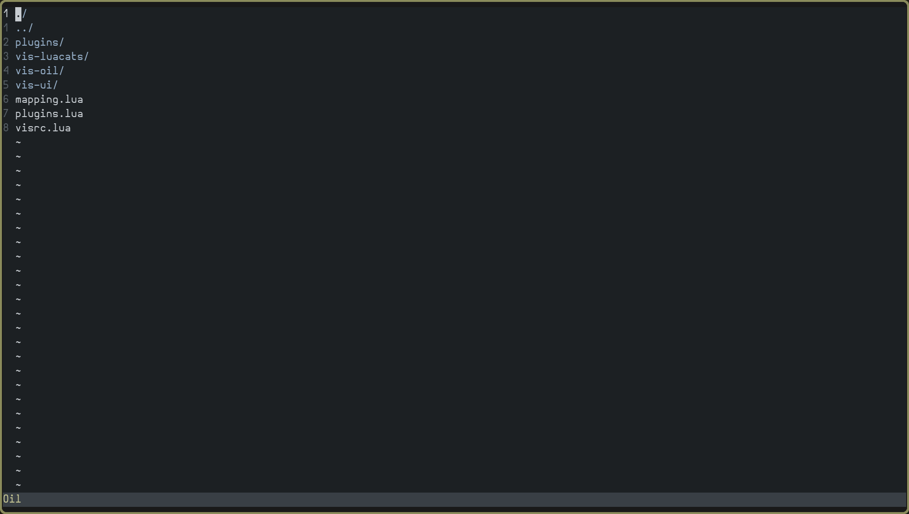

# vis-oil

> ⚠️ **Very early stage.** Expect bugs, missing features, and breaking changes.
> ⚠️ Not working on windows



An [`oil.nvim`](https://github.com/stevearc/oil.nvim)-inspired file manager
plugin for the [Vis](https://github.com/martanne/vis) editor.

Edit your filesystem like a text buffer.

### Whats implemented
- List cwd
- Traverse directory
- Open file

### Planned
- Copy
- Delete
- Rename
- Create
- Move
- Windows support

### Installation
With vis-plug
```lua
{ "newor0599/vis-oil", alias="oil" },
```


### Configuration
```lua
-- Show hidden files
oil.options.show_hidden = true

-- Map <Space>e to open oil in current buffer
oil:map_open_buffer(" e")

-- Map <Space>vv to open oil in a new vertical window
oil:map_open_vertical(" vv")

-- Map <Space>hh to open oil in a new horizontal window
oil:map_open_horizontal(" hh")
```

### Command usage
```lua
-- open oil at current buffer
:oil open_buffer

-- open oil vertically
:oil open_vertical

-- open oil horizontally
:oil open_horizontal
```
